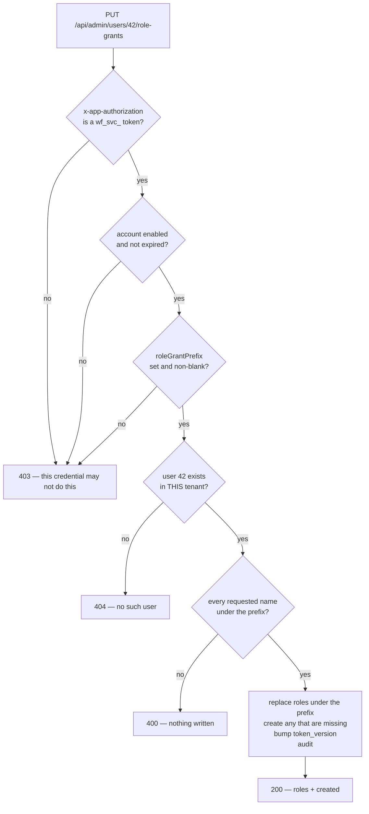
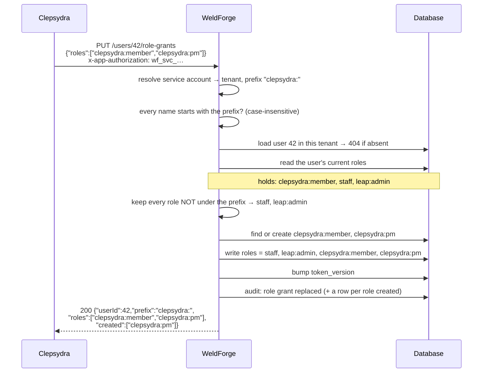

# Scoped role grants

**Status:** built in PR #153 (`V70`). **Written:** 2026-10-13.
**Prompted by:** the Clepsydra session's handover of 2026-10-13, at the owner's
request. Clepsydra's side of the plan is
`C:\dev\CWVermaak\Tech\clepsydra\docs\design\Clepsydra-Feature-Role-Assignment.md`
§4a; it builds against this contract behind a port, so a change here changes one
class there.

---

## 1. The problem

Clepsydra wants its own admins to assign Clepsydra roles — WeldForge roles named
`clepsydra:<role>` — from inside Clepsydra, with Clepsydra calling WeldForge.

Today the only credential that can assign a role is a service account with
`adminRole: TENANT_ADMIN`. That same credential can also delete users, reset
MFA, rotate secrets and edit OIDC clients for the **whole** `cwvermaak-tech`
tenant, which is shared with the admin portal, `leap` and `intellisuite`. Giving
it to a downstream application to set one namespace of role names is a grant
several orders of magnitude wider than the need.

The alternative in use today is worse: the roles are created and assigned by
hand in the portal. `clepsydra:member` was created that way on 2026-10-13, which
is what prompted this.

So: a credential that can assign roles under one name prefix and do nothing
else.

---

## 2. The contract

A service account gains an optional `roleGrantPrefix`, for example
`clepsydra:`. An account that has one may call exactly two endpoints:

| Method | Path | Body | Response |
|---|---|---|---|
| `GET` | `/api/admin/users/{id}/role-grants` | — | `{ "userId": 42, "prefix": "clepsydra:", "roles": [...] }` |
| `PUT` | `/api/admin/users/{id}/role-grants` | `{ "roles": [...] }` | `{ "userId": 42, "prefix": "clepsydra:", "roles": [...], "created": [...] }` |

`{id}` is the WeldForge user id, which is the `sub` in the OIDC tokens
Clepsydra receives.

Authentication is as for any service account: `x-app-authorization: wf_svc_…`.
The tenant is the service account's own; no tenant path segment or header is
involved, and `X-WF-Tenant` is not honoured on these endpoints (see §6).

**`GET` returns only the roles under the prefix.** A user holding
`clepsydra:member`, `staff` and `leap:admin` reads back as
`["clepsydra:member"]`. The caller is not told the other two exist.

**`PUT` replaces the user's roles under the prefix only** and leaves every
other role untouched, in one transaction. Sending `{"roles": []}` removes the
user's Clepsydra roles and nothing else.

Doing the replace server-side rather than read-modify-write in Clepsydra
removes the lost update when two changes race, and means Clepsydra never has to
create a role itself.

### Statuses

| Code | When |
|---|---|
| `200` | Done. `PUT` returns the resulting set. |
| `400` | A requested name is not under the caller's prefix, or is blank, or is too long. The whole call is refused; nothing is written. |
| `403` | The credential has no `roleGrantPrefix`, or is disabled or expired. |
| `404` | No such user in this service account's tenant. |

`400` rather than `403` for a name outside the prefix is deliberate, and agreed
with Clepsydra. `403` should mean "this credential may not do this at all",
which is a configuration problem a human must fix. A bad name in the payload is
a caller bug it can fix itself, and conflating the two makes Clepsydra's error
handling guess. An unknown user and a user in another tenant are both `404` for
the usual reason: the caller must not learn which tenant an id lives in.

### Refusing the whole call

One bad name refuses everything. The alternative — apply the valid names, skip
the rest — leaves the caller believing it set a state it did not set, and there
is no sensible status for "partly". Clepsydra builds names from a fixed
vocabulary, so a refusal here is a Clepsydra bug and should be loud.

---

## 3. The prefix match is case-insensitive

Not a preference. Role names are **already** unique without regard to case
(`RoleRepository.existsByTenantIdAndNameIgnoreCase`), so `clepsydra:member` and
`Clepsydra:member` are the same role as far as creation is concerned.

If the prefix filter were case-sensitive, a role stored as `Clepsydra:member`
would sit inside the namespace but be invisible to a `GET` filtering on
`clepsydra:`, and a `PUT` replacing everything under the prefix would fail to
remove it. The result is a role inside the namespace that the API owning the
namespace can neither see nor delete. Matching the uniqueness rule's
case-insensitivity makes that state unreachable.

Names are stored as the caller spelled them and compared lower-cased.

---

## 4. A missing role is created, and the response says so

`PUT` creates a named role that does not exist yet, in the same transaction.
That is the point of the feature: the pain that prompted it was a role being
created by hand.

The objection to create-on-use is that a caller bug silently litters the tenant
with roles. The answer is not a `createMissing` flag — Clepsydra would set it
`true` on every call, so it would add a field without adding a decision. The
answer is to stop it being silent:

- The `PUT` response carries a **`created`** array naming any role it had to
  create. A caller that expected to create nothing can assert on it.
- Creation is recorded in its own audit row, not folded into the assignment.

A created role gets a description saying which service account created it and
when, so an operator reading the Roles screen can tell a machine-created role
from one a person made.

---

## 5. When a role change is felt

This was asked directly and the answer has two halves, because WeldForge issues
two kinds of access token.

**OIDC access tokens — what Clepsydra validates.** The `roles` claim is queried
from the database at every issuance (`OidcTokenService.rolesFor`), so a rotated
token carries whatever the roles table says at that moment. A change is
therefore picked up on **the next refresh-token exchange**; no fresh sign-in is
needed.

A token already issued is **not** invalidated. It is a self-contained RS256 JWT
that Clepsydra verifies offline against the tenant JWKS, and nothing consults
the database when it is presented. **The revocation lag equals the
access-token lifetime.** Clepsydra has accepted that for now.

Since #152 (`V67`) that lag is a per-client setting: register the Clepsydra
client with a short `accessTokenTtlSeconds` and the lag shrinks to it, without
shortening every other client in the tenant. If near-immediate revocation is
ever needed, the answer is token introspection, not a very short TTL.

**Platform JWTs — WeldForge's own `/api/**`.** These carry no tenant `roles`
claim at all (`JwtService` emits `tid`, `tenant`, `sa`, `adm`, `ver`, `amr`,
`sid` and nothing else). Tenant roles are a claim for relying parties; they do
not drive WeldForge's own authorization, which runs off `adm` and `sa`.

### `token_version` is bumped

`AdminService.setUserRoles` bumps `users.token_version`, which
`JwtAuthenticationFilter` checks, ending the user's outstanding platform
sessions. This endpoint does the same.

It is worth being honest that the bump buys nothing *directly*: the roles that
changed live only in OIDC tokens, which `token_version` cannot reach. The
reason to do it anyway is that two writers of the same data behaving
differently is precisely the class of defect this codebase keeps paying for —
the second unaudited tenant selector in F54, the drifted inline form reset in
#151. One rule, "roles changed, platform sessions end", is worth a re-login.

In practice the blast radius is near zero: a Clepsydra user holds OIDC tokens,
not platform ones. It costs an admin-portal re-login only when the same person
happens to be signed into the portal.

---

## 6. Authorization: refuse, never fall back

**The guard lives in the service, not in the filter.** `AppAuthorizationFilter`
lets `/api/admin/**` through when **no** `x-app-authorization` header is
present, deferring to the JWT filter so the browser SPA can reach it. A new
endpoint under `/api/admin/**` is therefore *not* protected merely by being
there. This endpoint checks the caller explicitly.

The rule is a single answer with no second path, per
`docs/cross-tenant-admin-spec.md` §11:

- The caller **must** be a service account with a non-blank `roleGrantPrefix`.
- A human admin, however senior, is refused with `403`. A tenant admin already
  has the full role API at `PUT /api/admin/users/{id}/roles`; a second way to
  do the same thing is a second thing to keep correct.
- `adminRole` is irrelevant here and expected to be `NONE`. The prefix is the
  capability.
- The tenant is the service account's own, always. `X-WF-Tenant` is not
  honoured: a credential this narrow has no business reaching across tenants,
  and the cross-tenant selector exists for human admins with memberships.

---

## 7. What a replace actually does

The roles outside the prefix are carried through untouched. That is the whole
safety property: a credential scoped to `clepsydra:` cannot remove `staff`, and
cannot add it either.

---

## 8. The prefix itself

Stored on the service account as `role_grant_prefix`, nullable. Null or blank
means the account has no role-grant capability at all, which is every existing
account — this is additive and no current credential gains anything.

Validation when the prefix is set:

- Non-blank after trimming, at most 64 characters.
- Must not be so short that it is not a namespace. A one-character prefix like
  `c` would match `clepsydra:member` and also `customer-support`, which is not
  a namespace, it is a coincidence. Minimum **2** characters.
- The role-name rules apply to it as a fragment: no whitespace, since a role
  name with a space is a role nobody can address cleanly.

There is deliberately **no** requirement that it end in `:`. The delimiter is a
convention, not a rule, and hard-coding it would refuse a tenant that namespaces
with `-` or `/`. What matters is that it is long enough to be a namespace and
that one account's prefix is the whole of its reach.

**Not enforced:** that two service accounts' prefixes do not overlap. Two
accounts with `clepsydra:` and `clepsydra:pm:` would both be able to touch
`clepsydra:pm:ACME`. That is a real overlap, but refusing it means deciding
whose prefix wins at registration time for a configuration nobody has asked
for. It is written down here instead, and the audit row names the actor, so an
overlap is explicable after the fact.

---

## 9. Audit

Every call writes an audit row with the **service account** as the actor, which
`AppAuthorizationFilter` already puts in `TenantContext` via
`setActorServiceAccount`.

| Event | When |
|---|---|
| `user.role_grant.replaced` | A successful `PUT`. Metadata: the prefix, the resulting names under it, the names added and removed, and the user. |
| `user.role_grant.role_created` | One row per role the call had to create. Separate so creation is never buried inside an assignment. |
| `user.role_grant.refused` | A `PUT` refused for a name outside the prefix. Records the offending name — this is the row that shows a misconfigured or misbehaving downstream. |

A refused call is audited for the same reason a refused cross-tenant switch is:
the interesting security event is the attempt, and a request that writes nothing
leaves no other trace.

`GET` is not audited. It is a read of data the caller is entitled to and
auditing it would bury the writes.

---

## 10. What is not built

- **No portal screen for role grants.** The prefix is settable on the Service
  Accounts screen (§11), but there is no UI for assigning prefixed roles to a
  user — that is Clepsydra's job, which is the entire point.
- **No introspection-based immediate revocation.** The lag is the access-token
  lifetime, bounded per client since #152.
- **No overlap check between prefixes.** §8.
- **`refresh_token_ttl_s` still has no ceiling**, unlike the access TTL added in
  #152. Unrelated to this work, noted because it is the neighbouring gap.

---

## 11. Portal

The Service Accounts screen has a **Role grant prefix** field, optional, with
help text saying what it does. An account that carries one shows a second chip
in the list, `grants clepsydra:*`, so the capability is visible at a glance
rather than only in the API.

This is included rather than left API-only on purpose. The scope registry
(#150) and `resources` (#149) both shipped API-only and both are still
API-only, which means the only way to use them is a hand-written HTTP call. The
thing that prompted *this* work was an operator doing something by hand.
